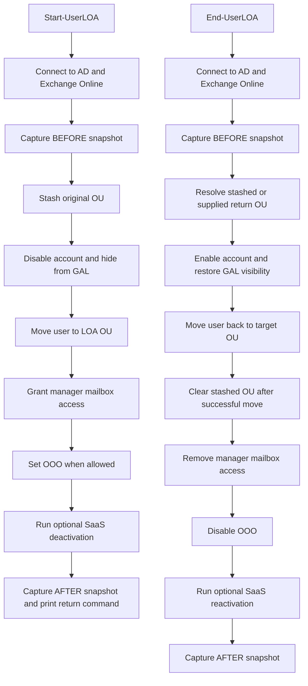

# Manage-UserLOA

`Manage-UserLOA` is a PowerShell module for hybrid Active Directory and Microsoft 365 environments. It handles the standard leave-of-absence lifecycle: disabling the account, moving the user into a leave OU, delegating mailbox access to the user's manager, setting out-of-office behaviour when appropriate, and reversing those changes when the user returns.

## Problem

Leave-of-absence workflows are often handled manually across Active Directory, Exchange Online, mailbox permissions, GAL visibility, and out-of-office settings. Manual handling creates risk: missed steps, inconsistent ticket notes, incomplete restoration, and unclear rollback paths.

This module turns the workflow into a repeatable, operator-driven process with before-and-after summaries, restore logic, and safety warnings.

## Public Commands

- `Start-UserLOA`
- `End-UserLOA`

## Features

- Disable and re-enable the AD account
- Move the user into and out of a leave OU
- Hide and restore the user from the GAL
- Stash the original OU for the return workflow
- Grant and remove manager mailbox `FullAccess` and `SendAs`
- Apply or remove OOO based on workflow rules
- Print before-and-after summaries for ticket notes
- Provide optional disabled-by-default Google Workspace and generic REST connector patterns
- Support `-WhatIf` and confirmation prompts on the public commands

## Repository Layout

```text
.
├── src/Manage-UserLOA/
├── examples/
├── docs/
├── tests/
├── README.md
├── LICENSE
├── SECURITY.md
├── CHANGELOG.md
└── .gitignore
```

## Prerequisites

- PowerShell 5.1 or later
- `ActiveDirectory` PowerShell module
- `ExchangeOnlineManagement` PowerShell module
- AD permissions to read and update target user objects and move users between the configured OUs
- Exchange Online rights to manage mailbox permissions, recipient permissions, and automatic replies

## Installation

```powershell
Import-Module 'C:\path\to\Manage-UserLOA\src\Manage-UserLOA\Manage-UserLOA.psd1'
```

For repeated use, place the `Manage-UserLOA` folder under a path listed in `$env:PSModulePath`.

## Configuration

Edit `$Script:Config` in [Manage-UserLOA.psm1](src/Manage-UserLOA/Manage-UserLOA.psm1) before use.

| Key | Type | Default | Description |
| --- | --- | --- | --- |
| `LOAOUDistinguishedName` | string | `OU=Users on Temporary Leave,OU=Corporate,DC=yourdomain,DC=com` | OU where disabled LOA users are moved |
| `DomainController` | string | `YOURDC.yourdomain.com` | Domain controller used for AD reads and writes |
| `OUStashAttribute` | string | `extensionAttribute10` | AD attribute used to store the original parent OU |
| `OOOSchedulingThreshold` | integer | `24` | Threshold in hours that triggers manual OOO review |
| `GoogleEnabled` | boolean | `$false` | Enables the Google Workspace connector |
| `GenericSaaSEnabled` | boolean | `$false` | Enables the generic REST connector |

Check that `OUStashAttribute` is not already used in your environment before deploying.

For a placeholder configuration template, see [config.example.ps1](examples/config.example.ps1).

## Usage Examples

Use `-WhatIf` first.

```powershell
Import-Module 'C:\path\to\Manage-UserLOA\src\Manage-UserLOA\Manage-UserLOA.psd1'
Start-UserLOA -UserPrincipalName 'jane.doe@yourdomain.com' -WhatIf
```

```powershell
Import-Module 'C:\path\to\Manage-UserLOA\src\Manage-UserLOA\Manage-UserLOA.psd1'
Start-UserLOA -UserPrincipalName 'jane.doe@yourdomain.com' -ManagerUPN 'john.smith@yourdomain.com' -ForceOOO -WhatIf
```

```powershell
Import-Module 'C:\path\to\Manage-UserLOA\src\Manage-UserLOA\Manage-UserLOA.psd1'
End-UserLOA -UserPrincipalName 'jane.doe@yourdomain.com' -ManagerUPN 'john.smith@yourdomain.com' -WhatIf
```

```powershell
Import-Module 'C:\path\to\Manage-UserLOA\src\Manage-UserLOA\Manage-UserLOA.psd1'
End-UserLOA -UserPrincipalName 'jane.doe@yourdomain.com' -ManagerUPN 'john.smith@yourdomain.com' -TargetOU 'OU=Sales,OU=Corporate,DC=yourdomain,DC=com' -WhatIf
```

Additional example scripts:

- [start-loa.example.ps1](examples/start-loa.example.ps1)
- [end-loa.example.ps1](examples/end-loa.example.ps1)
- [config.example.ps1](examples/config.example.ps1)

## Workflow Diagram



## Safety Controls

- The original OU is stashed before the LOA move
- The stashed OU is cleared only after a successful return move
- Both workflows print before-and-after summaries for the ticket
- The public commands support `-WhatIf` and `-Confirm`
- `Start-UserLOA` and `End-UserLOA` use high confirmation impact
- SaaS connector failures are non-blocking for the core AD and Exchange workflow
- Manual-review limitations are documented for pre-existing GAL hiding, mailbox permissions, OOO settings, and SaaS-specific state

## SaaS Integration Notes

The module includes optional patterns for:

- Google Workspace
- Generic REST APIs

These connectors are disabled by default. They show where the workflow can be extended to non-Microsoft SaaS tools without prescribing a single production integration model.

For real deployments, keep secrets out of the module and use SecretManagement, Azure Key Vault, environment variables, or another approved enterprise secrets platform.

## Testing Status

- Offline helper, metadata, and mocked workflow tests passed with Pester on June 27, 2026
- Live AD, Exchange Online, and SaaS validation remains manual

See:

- [docs/testing.md](docs/testing.md)
- [tests/README.md](tests/README.md)

## Rollback And Limitations

The module is designed around a reversible standard workflow, not a perfect historical rollback. It restores the common LOA changes: account enabled state, GAL visibility, OU location, manager mailbox delegation, OOO state, and any enabled SaaS connector patterns.

It does not preserve every pre-existing value. Existing mailbox permissions, existing GAL hiding, pre-existing OOO state, or SaaS application-specific state may require manual review and operator judgment.

## License

This project is licensed under the MIT License. See [LICENSE](LICENSE).
