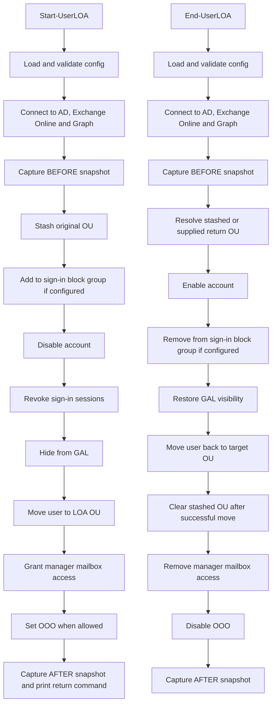

# Manage-UserLOA

`Manage-UserLOA` is a PowerShell module for hybrid Active Directory and Microsoft 365 environments. It handles the standard leave-of-absence lifecycle: disabling the account, moving the user into a leave OU, delegating mailbox access to the user's manager, setting out-of-office behaviour when appropriate, and reversing those changes when the user returns.

## Problem

Leave-of-absence workflows are often handled manually across Active Directory, Exchange Online, mailbox permissions, GAL visibility, and out-of-office settings. Manual handling creates risk: missed steps, inconsistent ticket notes, incomplete restoration, and unclear rollback paths.

This module turns the workflow into a repeatable, operator-driven process with before-and-after summaries, restore logic, and safety warnings.

## Public Commands

- `Start-UserLOA`
- `End-UserLOA`

## Features

- Disable and re-enable the AD account
- Revoke Microsoft 365 sign-in sessions after the disable, and optionally block sign-in at once through a Conditional Access group
- Move the user into and out of a leave OU
- Hide and restore the user from the GAL
- Stash the original OU for the return workflow
- Grant and remove manager mailbox `FullAccess` and `SendAs`
- Apply or remove OOO based on workflow rules
- Print before-and-after summaries for ticket notes
- Support `-WhatIf` and confirmation prompts on the public commands

## Repository Layout

```text
.
├── src/Manage-UserLOA/
├── examples/
├── docs/
├── tests/
├── README.md
├── LICENSE
├── SECURITY.md
├── CHANGELOG.md
└── .gitignore
```

## Prerequisites

- PowerShell 5.1 or later
- `ActiveDirectory` PowerShell module
- `ExchangeOnlineManagement` PowerShell module
- AD permissions to read and update target user objects and move users between the configured OUs
- Exchange Online rights to manage mailbox permissions, recipient permissions, and automatic replies
- Microsoft Graph PowerShell modules: `Microsoft.Graph.Authentication`, `Microsoft.Graph.Users`, `Microsoft.Graph.Users.Actions`, `Microsoft.Graph.Groups`
- The operator signs in to Graph interactively (delegated). Scopes requested: `User.Read.All` and `User.RevokeSessions.All`, plus `GroupMember.ReadWrite.All` when `SignInBlockGroupId` is set. An existing Graph session with these scopes is reused

## Installation

```powershell
Import-Module 'C:\path\to\Manage-UserLOA\src\Manage-UserLOA\Manage-UserLOA.psd1'
```

For repeated use, place the `Manage-UserLOA` folder under a path listed in `$env:PSModulePath`.

## Configuration

Settings live in a `.psd1` file. Both commands load it first and stop before connecting to anything if it is missing or invalid. The file is found in this order:

1. `-ConfigPath` on `Start-UserLOA` or `End-UserLOA`
2. The `MANAGE_USERLOA_CONFIG` environment variable
3. `$env:ProgramData\Manage-UserLOA\config.psd1`

Start from [config.example.psd1](examples/config.example.psd1). A local copy named `config.local.psd1` is git-ignored.

| Key | Required | Example | Description |
| --- | --- | --- | --- |
| `LOAOUDistinguishedName` | yes | `OU=Users on Temporary Leave,OU=Corporate,DC=yourdomain,DC=com` | OU where disabled LOA users are moved. Must start with `OU=` or `CN=` |
| `DomainController` | yes | `YOURDC.yourdomain.com` | Domain controller used for AD reads and writes |
| `OUStashAttribute` | yes | `extensionAttribute10` | AD attribute used to store the original parent OU. Must be `extensionAttribute1` to `extensionAttribute15` |
| `SignInBlockGroupId` | no | `''` | Object ID of the cloud-only sign-in block group. See below |

Validation reports every problem in the file at once. Unknown keys, such as settings from older versions, produce a warning and are ignored.

Check that `OUStashAttribute` is not already used in your environment before deploying. Never put secrets in the config file.

## Cutting off Microsoft 365 sign-in

Disabling the account in AD does not reach Entra ID until Entra Connect syncs it, which is about 30 minutes by default. Start therefore revokes the user's sign-in sessions right after the AD disable. Revoking alone is not enough: until the sync lands, the user can simply sign in again.

To close that gap, set `SignInBlockGroupId`. This needs a one-time setup by an Entra admin:

1. Create a **cloud-only** security group, for example `LOA-SignInBlocked`. A group synced from AD would wait for the same sync.
2. Create a Conditional Access policy: users = that group, target resources = all cloud apps, grant = **Block access**. Exclude your break-glass accounts.
3. Put the group's object ID in `SignInBlockGroupId`.

Conditional Access requires Entra ID P1 or higher. The module never creates or changes Conditional Access policies.

With the group set, Start adds the user to it before the AD disable, then revokes sessions. End removes the user after re-enabling the account. If adding to the group or revoking fails, Start stops at that point and tells you why. Rerunning Start after fixing the cause is safe. If End cannot remove the user from the group, it prints an `[ERR]` line and carries on, so remove them by hand.

Anyone who can change this group's membership can lock users out of Microsoft 365. Restrict who owns and manages it.

## Usage Examples

Use `-WhatIf` first.

```powershell
Import-Module 'C:\path\to\Manage-UserLOA\src\Manage-UserLOA\Manage-UserLOA.psd1'
Start-UserLOA -UserPrincipalName 'jane.doe@yourdomain.com' -WhatIf
```

```powershell
Import-Module 'C:\path\to\Manage-UserLOA\src\Manage-UserLOA\Manage-UserLOA.psd1'
Start-UserLOA -UserPrincipalName 'jane.doe@yourdomain.com' -ManagerUPN 'john.smith@yourdomain.com' -ForceOOO -WhatIf
```

```powershell
Import-Module 'C:\path\to\Manage-UserLOA\src\Manage-UserLOA\Manage-UserLOA.psd1'
End-UserLOA -UserPrincipalName 'jane.doe@yourdomain.com' -ManagerUPN 'john.smith@yourdomain.com' -WhatIf
```

```powershell
Import-Module 'C:\path\to\Manage-UserLOA\src\Manage-UserLOA\Manage-UserLOA.psd1'
End-UserLOA -UserPrincipalName 'jane.doe@yourdomain.com' -ManagerUPN 'john.smith@yourdomain.com' -TargetOU 'OU=Sales,OU=Corporate,DC=yourdomain,DC=com' -WhatIf
```

Additional example scripts:

- [start-loa.example.ps1](examples/start-loa.example.ps1)
- [end-loa.example.ps1](examples/end-loa.example.ps1)
- [config.example.psd1](examples/config.example.psd1)

## Workflow Diagram



## Safety Controls

- The original OU is stashed before the LOA move
- The stashed OU is cleared only after a successful return move
- Both workflows print before-and-after summaries for the ticket
- The public commands support `-WhatIf` and `-Confirm`
- `Start-UserLOA` and `End-UserLOA` use high confirmation impact
- Manual-review limitations are documented for pre-existing GAL hiding, mailbox permissions, and OOO settings

## Testing Status

I tested v1.0 against a production AD and Exchange Online environment. v1.1 and later are validated against a fake tenant in the test suite.

See:

- [docs/testing.md](docs/testing.md)
- [tests/README.md](tests/README.md)

## Rollback And Limitations

The module is designed around a reversible standard workflow, not a perfect historical rollback. It restores the common LOA changes: account enabled state, GAL visibility, OU location, manager mailbox delegation, and OOO state.

Revoked sign-in sessions cannot be restored. This is by design: the user simply signs in again after End.

It does not preserve every pre-existing value. Existing mailbox permissions, existing GAL hiding, or pre-existing OOO state may require manual review and operator judgment.

## License

This project is licensed under the MIT License. See [LICENSE](LICENSE).
